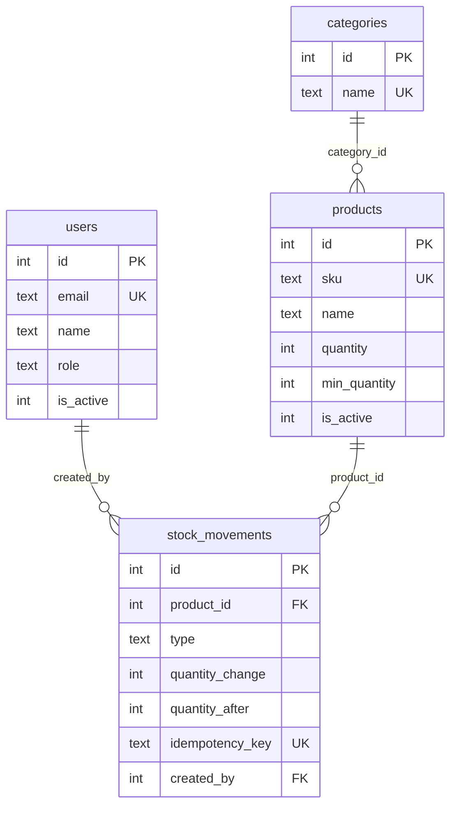

# inventory-management
Inventory management app: React, Express, SQLite, JWT roles

# Inventory Management

Ứng dụng quản lý sản phẩm, tồn kho và cảnh báo hàng sắp hết.

**Stack:** React + Vite + Tailwind, Node.js + Express, SQLite, JWT (admin/staff), Vitest + Supertest.

> Đang phát triển.
# Inventory Management System (IMS)


Ứng dụng quản lý kho: theo dõi tồn kho theo sổ cái biến động, cảnh báo sắp hết hàng, phân quyền admin/staff.

**Demo:** <link-cloudflare-pages>
**Tài khoản:** `admin@demo.com` hoặc `staff@demo.com`, mật khẩu `Demo@12345`

> Backend demo chạy trên gói miễn phí: lần truy cập đầu có thể chờ 30-60 giây, dữ liệu demo được reset khi máy chủ khởi động lại.


## Tính năng
- Đăng nhập JWT, 2 vai trò: admin và staff
- Quản lý sản phẩm, danh mục, tìm kiếm theo tên/SKU, lọc, phân trang
- Nhập (IN), xuất (OUT), điều chỉnh sau kiểm kê (ADJUST) với lý do bắt buộc
- Cảnh báo sắp hết hàng khi `quantity <= min_quantity`
- Dashboard tổng quan và lịch sử biến động có bộ lọc theo loại, ngày

## Phân quyền
| Thao tác | admin | staff |
|---|:---:|:---:|
| Xem sản phẩm, danh mục, lịch sử, dashboard | ✅ | ✅ |
| Nhập, xuất kho | ✅ | ✅ |
| Điều chỉnh tồn kho (ADJUST) | ✅ | ❌ |
| Thêm/sửa sản phẩm, thêm danh mục | ✅ | ❌ |
| Tạo tài khoản | ✅ | ❌ |

## Công nghệ
React, Vite, TypeScript, Tailwind, TanStack Query · Node.js, Express, SQLite (better-sqlite3), zod · JWT, bcrypt · Vitest, Supertest · GitHub Actions

## Cơ sở dữ liệu


## Quyết định thiết kế
- **Sổ cái bất biến:** `stock_movements` chỉ thêm, không sửa/xóa (trigger chặn ở DB). Sai thì tạo movement bù.
- **Một cửa duy nhất đổi tồn kho:** chỉ hàm `recordMovement()` được đổi `products.quantity`, trong một transaction cùng với ghi sổ cái.
- **Chống tồn kho âm 2 lớp:** `UPDATE ... WHERE quantity + delta >= 0` trong code và `CHECK (quantity >= 0)` ở DB.
- **Idempotency-Key:** gửi lại cùng một request (mất mạng, bấm đúp) không làm trừ kho hai lần.
- **Đồng thời:** SQLite chỉ có một writer; transaction `IMMEDIATE` và WAL giúp các lần ghi xếp hàng tuần tự.
- **Vì sao SQLite:** đủ cho một kho, không cần dựng máy chủ riêng. Truy vấn gói trong lớp repository nên chuyển PostgreSQL chỉ sửa ở lớp đó.
- **Test:** API được test bằng Supertest trên SQLite `:memory:` qua `createApp(db)`, kèm bài kiểm tra đối soát `SUM(quantity_change) = quantity`.

## Chạy trên máy (Windows PowerShell)
Cần Node.js 20 trở lên.
```powershell
git clone https://github.com/<tai-khoan>/inventory-management.git
cd inventory-management
npm install
$secret = node -e "console.log(require('crypto').randomBytes(32).toString('hex'))"
Set-Content -Path server/.env -Value "JWT_SECRET=$secret" -Encoding ascii
npm run seed
npm run dev          # API: http://localhost:3000
npm run dev:client   # Web: http://localhost:5173
```
Chạy test: `npm test`

## Tài liệu
- [API](docs/api-spec.md)
- [Quy tắc nghiệp vụ kho](docs/inventory-rules.md)

## Giới hạn đã biết
- Token lưu `sessionStorage` (dễ bị XSS đọc hơn cookie httpOnly) và còn hiệu lực tối đa 1 giờ sau khi tài khoản bị vô hiệu hóa.
- Chưa có chức năng đổi mật khẩu hay vô hiệu hóa người dùng qua giao diện.
- SQLite chỉ phù hợp một kho, một máy chủ. Nhiều kho hoặc nhiều máy chủ cần PostgreSQL.
- Tên danh mục phân biệt hoa thường.
- Chưa có lô/hạn sử dụng, hàng giữ chỗ, hàng đang về.

## Hướng phát triển
Theo dõi lô và hạn sử dụng, đặt trước hàng (reserved), nhiều kho, chuyển sang PostgreSQL, cookie httpOnly cho token.