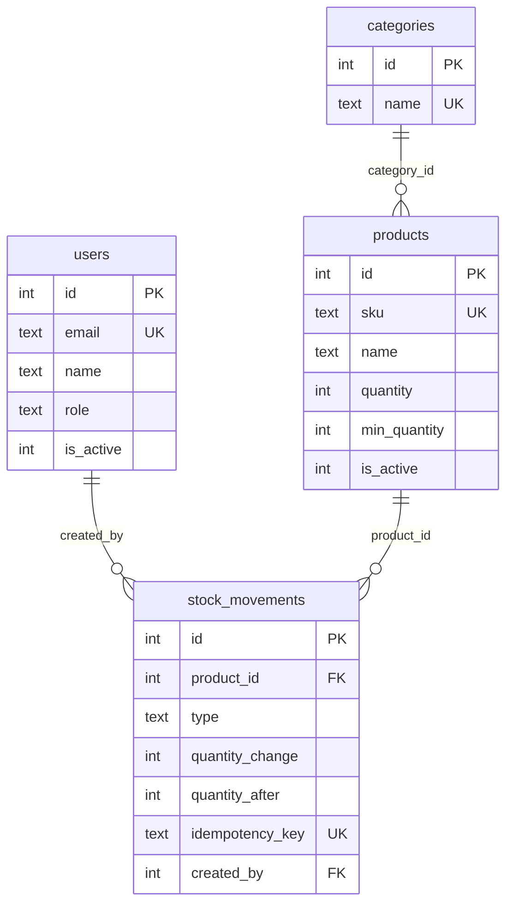

# inventory-management
Inventory management app: React, Express, SQLite, JWT roles

# Inventory Management

Manage products, track inventory, and get low-stock alerts.

**Stack:** React + Vite + Tailwind, Node.js + Express, SQLite, JWT (admin/staff), Vitest + Supertest.

> In development.
# Inventory Management System (IMS)


Inventory management app: track stock through a movement ledger, get low-stock alerts, and manage admin/staff roles.

**Demo:** <https://inventory-management.nhokconpero123.workers.dev/>
**Accounts:** `admin@demo.com` or `staff@demo.com`, password `Demo@12345`


## Features
- JWT login with two roles: admin and staff
- Manage products and categories; search by name/SKU, filter, and paginate
- Stock in (IN), stock out (OUT), and post-inventory adjustments (ADJUST) with a required reason
- Low-stock alerts when `quantity <= min_quantity`
- Dashboard and movement history with filters by type and date

## Permissions
| Action | admin | staff |
|---|:---:|:---:|
| View products, categories, history, dashboard | ✅ | ✅ |
| Stock in and stock out | ✅ | ✅ |
| Adjust stock (ADJUST) | ✅ | ❌ |
| Add/edit products, add categories | ✅ | ❌ |
| Create accounts | ✅ | ❌ |

## Technology
React, Vite, TypeScript, Tailwind, TanStack Query · Node.js, Express, SQLite (better-sqlite3), zod · JWT, bcrypt · Vitest, Supertest · GitHub Actions

## Database


## Design Decisions
- **Immutable ledger:** `stock_movements` is append-only; updates and deletes are blocked by database triggers. Correct mistakes with a compensating movement.
- **Single stock update path:** only `recordMovement()` can change `products.quantity`, in the same transaction as the ledger entry.
- **Two layers of negative-stock protection:** `UPDATE ... WHERE quantity + delta >= 0` in code and `CHECK (quantity >= 0)` in the database.
- **Idempotency-Key:** retrying the same request (due to network loss or a double-click) does not deduct stock twice.
- **Concurrency:** SQLite has a single writer; `IMMEDIATE` transactions and WAL serialize writes.
- **Why SQLite:** sufficient for a single warehouse without a separate database server. Queries are isolated in the repository layer, so switching to PostgreSQL only requires changes there.
- **Testing:** The API is tested with Supertest on SQLite `:memory:` through `createApp(db)`, including a reconciliation check for `SUM(quantity_change) = quantity`.

## Run locally (Windows PowerShell)
Requires Node.js 20 or later.
```powershell
git clone https://github.com/<username>/inventory-management.git
cd inventory-management
npm install
$secret = node -e "console.log(require('crypto').randomBytes(32).toString('hex'))"
Set-Content -Path server/.env -Value "JWT_SECRET=$secret" -Encoding ascii
npm run seed
npm run dev          # API: http://localhost:3000
npm run dev:client   # Web: http://localhost:5173
```
Run tests: `npm test`

## Documentation
- [API](docs/api-spec.md)
- [Inventory rules](docs/inventory-rules.md)

## Known limitations
- Tokens are stored in `sessionStorage` (more exposed to XSS than httpOnly cookies) and remain valid for up to one hour after an account is deactivated.
- The UI does not yet support changing passwords or deactivating users.
- SQLite is suitable for a single warehouse and server. Multiple warehouses or servers require PostgreSQL.
- Category names are case-sensitive.
- Batch/expiry tracking, reserved stock, and incoming stock are not yet supported.

## Roadmap
Batch and expiration tracking, stock reservations, multiple warehouses, migration to PostgreSQL, and httpOnly cookies for tokens.